## Definition
A flowchart is a pictorial way of visualizing each step of a program/code using distinct shapes to represent different functionalities of the code.

| Shape             | Use                                   |
| ----------------- | ------------------------------------- |
| Ellipse (stadium) | Start / End                           |
| Parallelogram     | Input (prompt/read) or Output (print) |
| Rectangle         | Calculation / variable assignment     |
| Diamond           | Condition (if/else, loop test)        |
| Circle            | Connector — flow merges or splits     |
| Arrow             | Execution order                       |

---

## Sequential Flow

Pattern: `Start → Input → Process → Output → End`

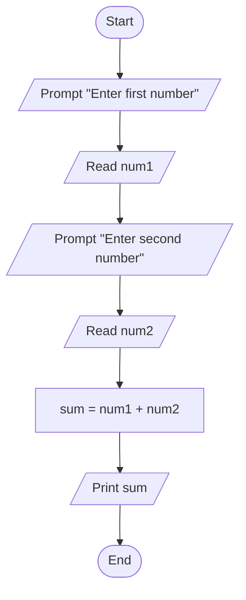

---

## Decision Making (if / else)

Diamond = condition, two branches (True/False), both merge back to one path.

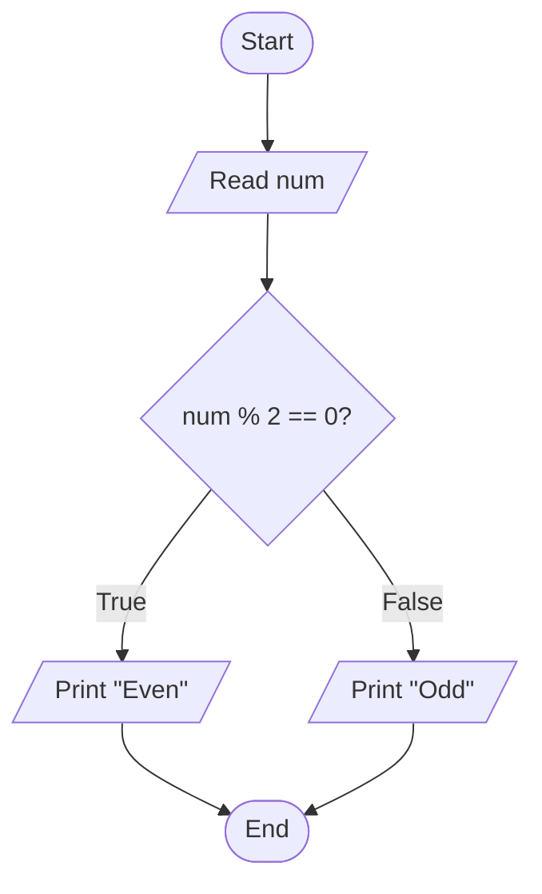

**Nested if/else** — chain another diamond off the False branch:

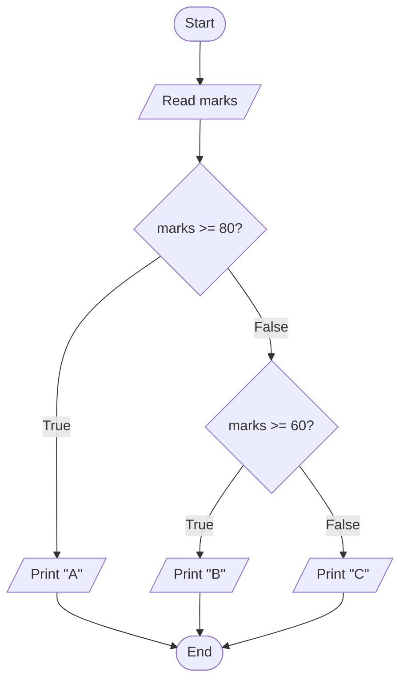

## Loops
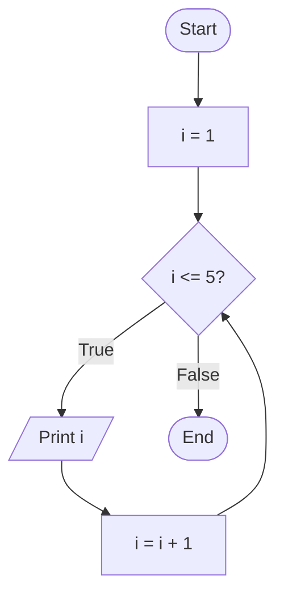

### Running sum pattern:
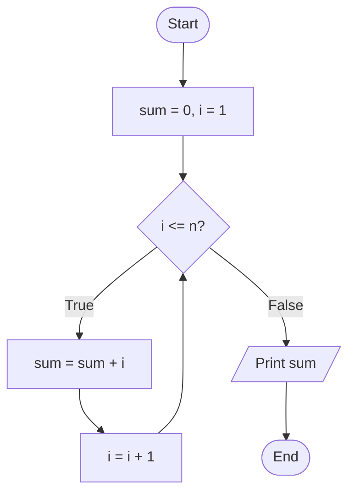
## Nested Loops
Outer loop's body contains a **complete** inner loop — its own init, condition, and update. Inner loop runs to completion for every single outer iteration.

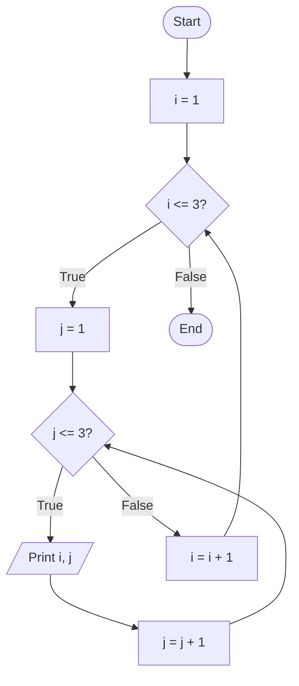

**Key point:** `j` resets to 1 every time `i` advances — that's what makes it nested, not two separate loops.

---
## Quick Reference
- **Sequence:** Start → I/O → Process → I/O → End
- **Decision:** diamond, two labeled branches, merge back to one path
- **Loop:** diamond condition, body, update, arrow back to condition
- **Nested loop:** outer body = full inner loop (init → condition → body → update → loop back)

# Worksheet:
1. Write a short description and draw a flowchart to make a cup of tea or coffee. The steps could vary person to person.
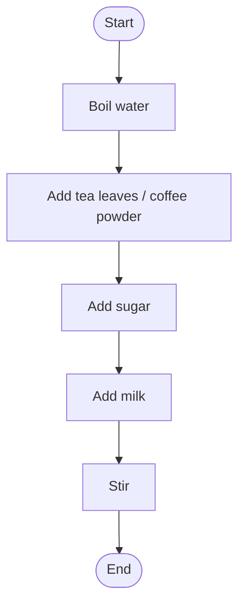
2. Draw a flowchart to find the result of addition of two numbers given by a user. Also, find their average.
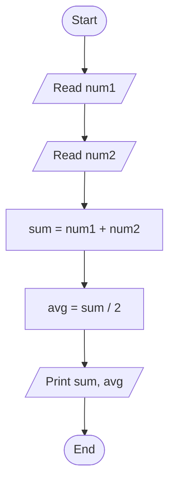
3. Draw a flowchart to take temperature in Fahrenheit and convert it to Celsius and print it.
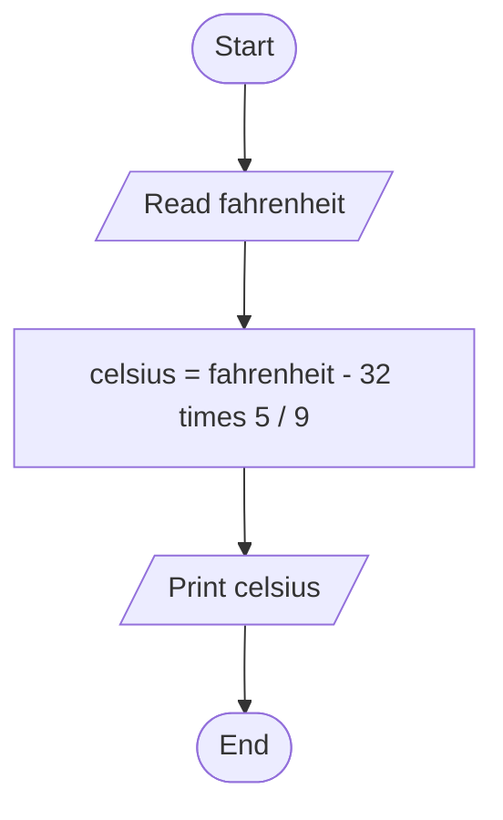
4.  Draw a flowchart which takes a number from the user and then multiply it with 10, then add 2050 to the result and divide the number by 5 and show the final result as output.
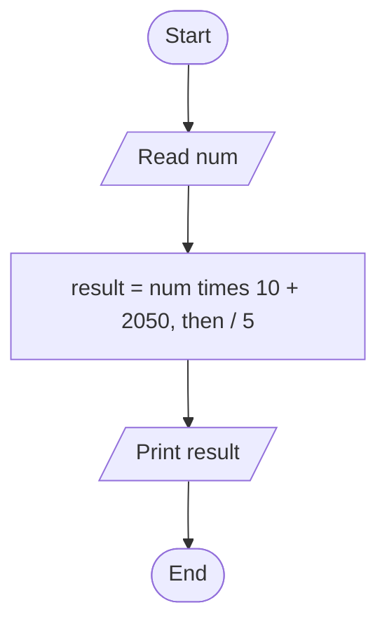
5. Write a flowchart that finds the number of hours, minutes, and seconds in a given number of seconds. For example, how many hours, minutes, and seconds are there in 10,000 seconds?
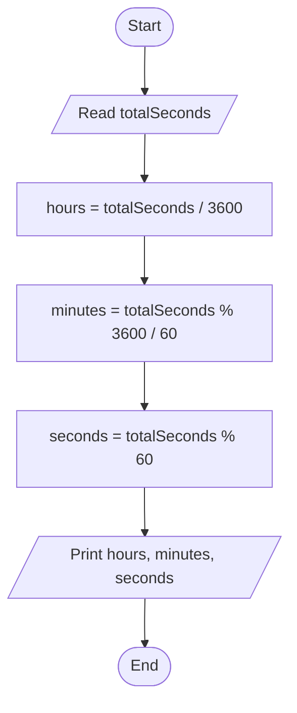
6. Write a flowchart to print the area of a triangle taking base and height input from the user.
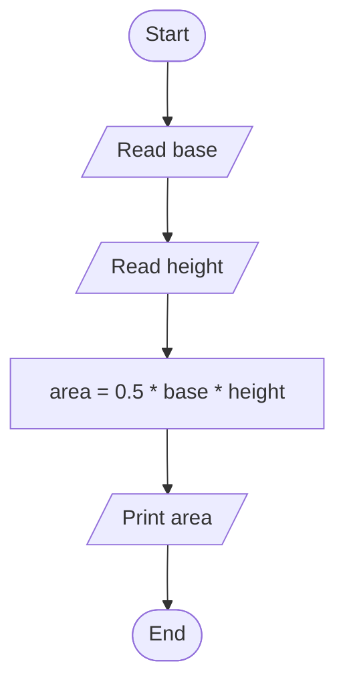
7. Write a flowchart that reads the values for the three sides x, y, and z of a triangle, and then calculates its area. The area is calculated as follows: Area = s (s − x) (s − y) (s − z), where s is (x + y + z)/2
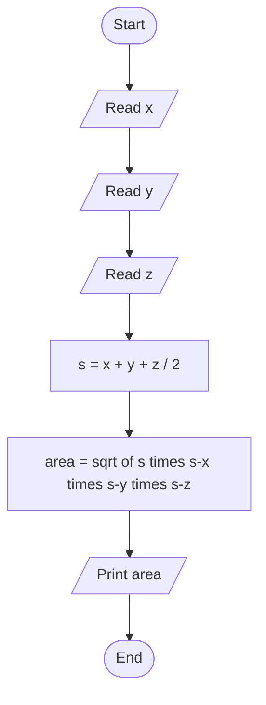
8. Assume there are two variables x and y. Take Values of these variables from the user. For example, the user gave the following two values. x = 46; y = 27; Now exchange / swap values in such a way so that printing the variable x gives 27 and y gives 46.
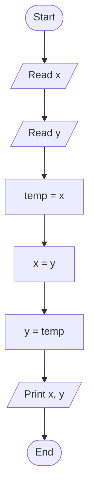
9. Take the value of a, b, c from the user. Then swap the values and print in such a way that: Value of a goes to b, Value of b goes to c, Value of c goes to a
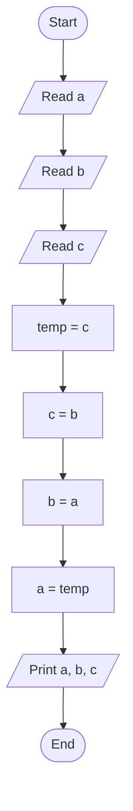
10. Suppose a government employee has to pay 3000 taka plus 2.5% tax of his yearly salary. Now take the salary input from a user and print his tax.
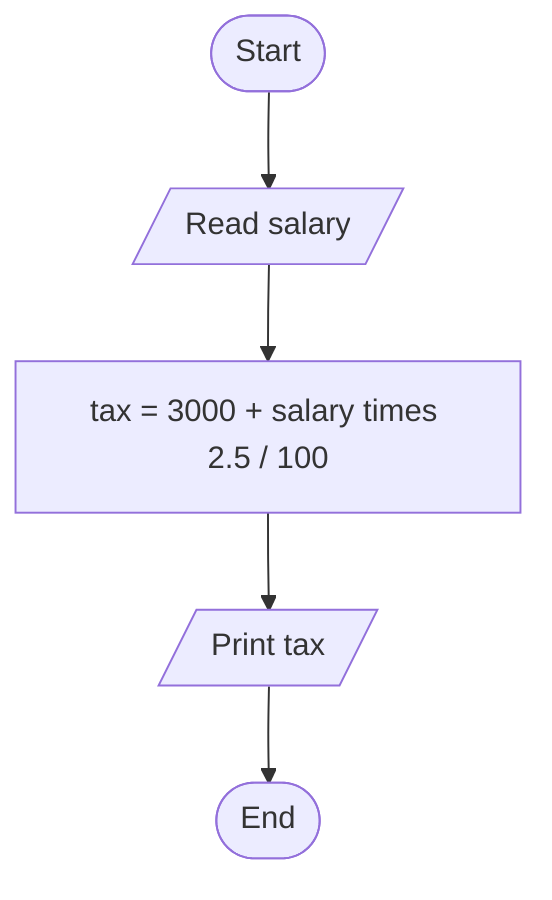
