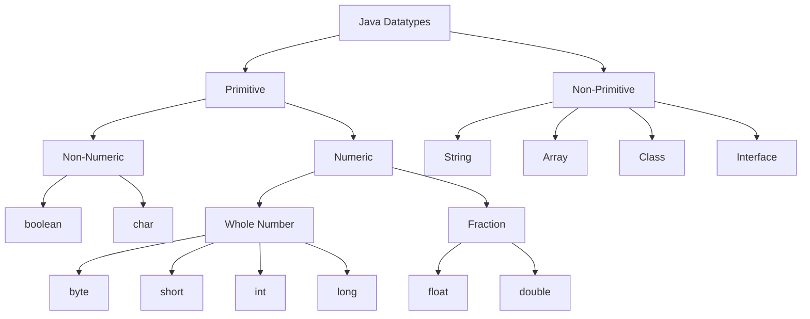
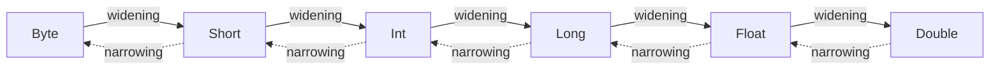

# 2.1 Variables
A variable is an identifier used to store a data value. Declaring a variable reserves a space in memory so that a value can be stored, accessed, and later modified.

# 2.2 Variable Naming Convention
Java enforces a specific set of rules for naming variables:
-  Must begin with a letter (A-Z, a-z), a dollar sign (`$`), or an underscore (`_`)
-  Case sensitive — `name` and `Name` are treated as two different variables
-  No white spaces allowed
-  Digits (0-9) are allowed, but not as the first character
-  No special characters other than `$` and `_`
-  Multi-word names use camelCase (`yourFirstName`) or snake_case (`your_first_name`)
-  Cannot match a reserved keyword
-  Should be meaningful and descriptive of what they store
-  Should not be a single character
# 2.3 Reserved Keywords in Java
Reserved keywords carry special meaning in the language and cannot be used as identifiers;

| abstract | assert   | boolean  | synchronized | byte   | case   | catch   | char      | class    |
| -------- | -------- | -------- | ------------ | ------ | ------ | ------- | --------- | -------- |
| continue | default  | do       | double       | else   | enum   | extends | final     | finally  |
| float    | for      | if       | implements   | import | int    | long    | native    | new      |
| null     | package  | private  | instanceOf   | public | return | short   | static    | strictfp |
| super    | switch   | break    | interface    | this   | throw  | throws  | transient | try      |
| void     | volatile | while    | protected    | const  | goto   | true    | false     | null     |
| exports  | module   | requires | var          |        |        |         |           |          |

# 2.4 Datatypes
Every variable in Java must have a specific datatype. Datatypes fall into two broad categories:
- **Primitive**: holds an actual value directly
- **Non-Primitive**: holds a reference to an object or memory location



| Category      | Name      | Size (bytes) | Range / Explanation                                                  | Example                        |
| ------------- | --------- | ------------ | -------------------------------------------------------------------- | ------------------------------ |
| Primitive     | `byte`    | 1            | Whole numbers from -128 to 127 (-2^7 to 2^7-1)                       | `byte b1 = 51;`                |
|               | `short`   | 2            | Whole numbers from -32,768 to 32,767 (-2^15 to 2^15-1)               | `short s1 = 513;`              |
|               | `int`     | 4            | Whole numbers from -2,147,483,648 to 2,147,483,647 (-2^31 to 2^31-1) | `int i1 = 5456;`               |
|               | `long`    | 8            | Whole numbers from -2^63 to 2^63-1                                   | `long l1 = 12345788;`          |
|               | `float`   | 4            | Fractional numbers, ~6-7 decimal digits of precision                 | `float f1 = 5.0f;`             |
|               | `double`  | 8            | Fractional numbers, ~15 decimal digits of precision                  | `double d1 = 123.4558428743d;` |
|               | `boolean` | 1            | Either `true` or `false`                                             | `boolean b1 = true;`           |
|               | `char`    | 2            | A single character from the ASCII set                                | `char c1 = 'A';`               |
| Non-Primitive | `String`  | —            | A sequence of characters                                             | `String s1 = "Hello";`         |
|               | `Array`   | —            | Multiple values of the same datatype                                 | `int[] arr = {1, 2, 3};`       |

# 2.5 Primitive vs Non-Primitive

| Primitive                                  | Non-Primitive                                         |
| ------------------------------------------ | ----------------------------------------------------- |
| Predefined, no need to create before using | Must be created before using (except `String`)        |
| Contains a value                           | Contains a reference                                  |
| Cannot be `null`                           | Can be `null`                                         |
| Size depends on the specific data type     | All non-primitive types share the same reference size |

# 2.6 Declaration, Assignment, and Initialization

- **Declaration**: allocating memory space while specifying the datatype of a variable
- **Assignment**: assigning a value to a variable that has already been declared
- **Initialization**: allocating memory *and* assigning a value in the same statement

```java
int a;      // declaration
a = 5;      // assignment
int a = 5;  // initialization (declaration + assignment combined)
```

General syntax:
```
<datatype> <variable name> = <value><format specifier>;
// format specifiers only apply to float and double
```

```java
byte b1 = 51;
short s1 = 513;
int i1 = 5456;
long l1 = 12345788;
float f1 = 5.0f;
double d1 = 123.4558428743d;
boolean b1 = true;
char c1 = 'A';
String s1 = "Hello";
int[] a = {10, 20, 100};
```
# 2.7 Datatype Conversion Basics

**Type** refers to a variable's datatype, and **casting** is the process of converting a value from one datatype to another. Casting changes only the type — the underlying data itself is not altered.
- **Widening / Implicit casting** — converting a smaller-capacity type to a larger-capacity type. No data is lost, and Java performs it automatically without any explicit code.
  ```java
  int num = 10;
  double data = num; // automatic widening, no cast needed
  ```
- **Narrowing / Explicit casting** — converting a larger-capacity type to a smaller-capacity type. Because this can lose data, Java requires you to do it manually with a cast operator.
  ```java
  double num = 10.99;
  int data = (int) num; // explicit cast required
  ```



The conversion matrix below shows, for any pair of types, whether Java will auto-assign the value or require an explicit cast:

| From \ To | Byte | Char | Short | Int | Long | Float | Double |
|---|---|---|---|---|---|---|---|
| **Byte** | Auto | Cast | Cast | Cast | Cast | Cast | Cast |
| **Char** | Cast | Auto | Cast | Cast | Cast | Cast | Cast |
| **Short** | Auto | Cast | Auto | Cast | Cast | Cast | Cast |
| **Int** | Auto | Auto | Auto | Auto | Cast | Cast | Cast |
| **Long** | Auto | Auto | Auto | Auto | Auto | Cast | Cast |
| **Float** | Auto | Auto | Auto | Auto | Auto | Auto | Cast |
| **Double** | Auto | Auto | Auto | Auto | Auto | Auto | Auto |

*"Auto" = widening/implicit casting; "Cast" = narrowing/explicit casting required.*

# 2.8 Numeric-to-Numeric Conversion

| Conversion | Type | Code | Explanation |
|---|---|---|---|
| int → float / double | Widening | `int num = 10;`<br>`double data = num; // 10.0`<br>`float data2 = num; // 10.0` | The int is converted to the target type automatically, then assigned. |
| double / float → int | Narrowing | `double num = 10.99d;`<br>`float num2 = 10.25f;`<br>`int data = (int)num; // 10`<br>`int data2 = (int)num2; // 10` | The `(int)` cast strips the fractional part — this is where data loss (lossy conversion) occurs. |
| float → double | Widening | `float num = 127.45f;`<br>`double d = (double)num;`<br>`System.out.println(d);`<br>`// 127.44999694824219` | Note the small precision artifact — float's lower precision doesn't map cleanly onto double. |
| double → float | Narrowing | `double num = 1.123456789d;`<br>`float f = (float)num;`<br>`System.out.println(f);`<br>`// 1.1234568` | Precision is reduced to fit float's smaller capacity. |
| int → byte | Narrowing | `int num = 127;`<br>`byte b = (byte)num;`<br>`System.out.println(b);`<br>`// 127` | Only works cleanly for int values within byte's range (-128 to 127); values outside that range wrap around rather than throwing an error. |

# 2.9 Numeric-to-Non-Numeric and Vice-Versa Conversion

| Conversion | Code | Explanation |
|---|---|---|
| int → String | `String x = String.valueOf(15);`<br>`String y = Integer.toString(20);`<br>`System.out.println(x+y);`<br>`// 1520` | Both `String.valueOf()` and `Integer.toString()` convert an int to its String representation. Since `x` and `y` are Strings here, `x+y` is concatenation, not addition — giving `"15"+"20" = "1520"`. |
| String → int | `int n = Integer.parseInt("25");`<br>`int m = Integer.valueOf("35");`<br>`System.out.println(m+n);`<br>`// 60` | `Integer.parseInt()` returns a primitive `int`; `Integer.valueOf()` returns an `Integer` object. Both throw `NumberFormatException` if the string isn't a valid integer. Here `m+n` is numeric addition: 25+35=60. |
| int → char | `int a = 65;`<br>`char c = (char)a;`<br>`System.out.println(c); // A` | The int is treated as an ASCII code point and cast to its corresponding character. |
| char → int | `char a = 'Z';`<br>`int c = (int)a;`<br>`System.out.println(c); // 90` | The character is converted to its underlying ASCII value. |

Converting `char` to/from `String` is covered later, in Chapter 9: Strings.

# 2.10 Worksheet

**A. Trace the following code and write the output for each line.**
```java
class B {
    public static void main(String[] args) {
        int a = 15;
        int b = 4;
        System.out.println(a+b);
        float a1 = a;
        float b1 = b;
        String a2 = Integer.toString(a);
        String b2 = Integer.toString(b);
        System.out.println(a1+b1);
        System.out.println(a1 == a);
        System.out.println(a2+b2);
        System.out.println(a2+"Hi"+b2);
        System.out.println("Hi"+Integer.toString(b+1));
    }
}
```

| Line | Code                                              | Output |
| ---- | ------------------------------------------------- | ------ |
| 1    | `System.out.println(a+b);`                        | 19     |
| 2    | `System.out.println(a1+b1);`                      | 19.0   |
| 3    | `System.out.println(a1 == a);`                    | true   |
| 4    | `System.out.println(a2+b2);`                      | 154    |
| 5    | `System.out.println(a2+"Hi"+b2);`                 | 15Hi4  |
| 6    | `System.out.println("Hi"+Integer.toString(b+1));` | Hi5    |

**B. Fill in the missing code so the program produces the given output.**
```java
class A {
    public static void main(String[] args) {
        int x = 5;
        int y = 7;
        System.out.println(x+y);
        // your code here
		float x1 = x;
		float y1 = y;
		String x2 = Integer.toString(x);
		String y2 = Integer.toString(y);
        System.out.println(x1+y1);
        System.out.println(x2+y2);
    }
}
```

Expected output:
```
12
12.0
57
```

**C. Which of the following are invalid variable names, and why?**
`N1`, `num2`, `2num`, `num_1`, `firstName`, `first1name`, `hi 1`, `first_1_name`, `first-name`, `import`, `long`, `import1`

| Invalid Variable Name | Reason for Being Invalid |
| --------------------- | ------------------------ |
| 2num                  | starts with a digit      |
| hi 1                  | contains a whitespace    |
| first-name            | hyphen is not allowed    |
| import                | reserved keyword         |
| long                  | reserved keyword         |

**D.** What is the difference between declaring, assigning, and initializing a variable? Can the same variable be declared, assigned, or initialized multiple times in Java?
	 Declaring reserves memory and fixes the datatype, no value yet:`int a;`
	 Assigning gives a value to an already-declared variable: `a = 5;`
	Initialising is declaration and assignment combined: `int a = 5;`

**E.** Explain lossy conversion with code examples.
	Lossy conversion happens during narrowing casts, when a value moves from a type with more range/precision into one with less, data gets truncated or wraps around.
```java
double num = 10.99;
int data = (int) num; //10

double precise = 1.123456789;
float f = (float) precise; //1.1234568

int num2 = 130;
byte b = (byte) num2 //-126
```
