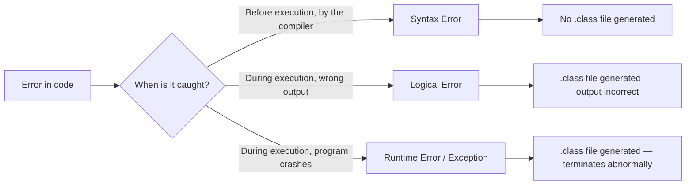

# 6.1 Overview
Errors in Java fall into three categories, distinguished by *when* they surface and *how* they behave:
- **Syntax Errors** — caught by the compiler before the program runs
- **Logical Errors** — the program runs fine but produces the wrong output
- **Runtime Errors (Exceptions)** — the program compiles and starts, but crashes mid-execution

---
# 6.2 Syntax Errors
Syntax errors happen when code violates Java's grammar — missing punctuation, misspelled keywords, wrong casing, and similar mistakes. They're the easiest errors to catch: the compiler flags them immediately, line number included. Since the error is caught before the program ever runs, no `.class` file is produced — which is why syntax errors are also called **compile-time errors**.

| Cause                               | Example                                    | Error Shown                         |
| ----------------------------------- | ------------------------------------------ | ----------------------------------- |
| Missing semicolon                   | `System.out.println("Hi")`                 | `';' expected`                      |
| Unclosed parenthesis                | `System.out.println("Hi!";`                | `')' expected`                      |
| Unclosed curly braces               | see below                                  | `reached end of file while parsing` |
| Misspelled keyword                  | `public staic void main(String[] args) {`  | `<identifier> expected`             |
| Wrong-cased keyword                 | `Public static void main(String[] args) {` | `<identifier> expected`             |
| Reserved word used as variable name | `public= x; // reserved keyword`           | `illegal start of expression`       |
| Variable name starting with a digit | `1name = 10;`                              | `not a statement`                   |
| Missing closing quote in a string   | `System.out.println("Hi);`                 | `unclosed string literal`           |
| Using an undeclared variable        | `print(x); // x not declared`              | `cannot find symbol`                |
| Missing or excessive operators      | `y = 3 + * 5;`                             | `illegal start of expression`       |

```java title:"Unclosed curly brace example:"
class HelloWorld {
    public static void main(String[] args) {
        x = 1;
}
```
The closing brace for `main` (and the class) is missing, so the compiler reaches the end of the file still expecting more code.

---
# 6.3 Logical Errors
Logical errors occur when the code is syntactically correct, compiles cleanly, and runs without any error message — but the output is wrong. These are the hardest category to catch precisely *because* nothing looks broken; the only sign is that the result doesn't match expectations.
```java
x = 1;
y = 5;
System.out.println(x*y); // intended: x + y
```
Expected output: `6`
Actual output: `5`

The code executes fine — `*` was used where `+` was intended, and Java has no way of knowing that wasn't your intent. There's no compiler shortcut for this category: catching a logical error means manually tracing through the code and checking each step against the output you expected.

---
# 6.4 Runtime Errors (Exceptions)
Runtime errors happen after the program compiles successfully and starts running — a `.class` file exists — but something goes wrong mid-execution that the program can't recover from, causing it to terminate abnormally with an error message. These are also called **exceptions**.

| Cause | Example | Exception Thrown |
|---|---|---|
| Division by zero | `System.out.println(5/0);` | `java.lang.ArithmeticException: / by zero` |
| Input type mismatch | `int x = myObj.nextInt();` (user types a String instead) | `java.util.InputMismatchException` |
| Null pointer access | see below | `java.lang.NullPointerException` |
| Invalid numeric conversion | `int x = Integer.parseInt("Hi");` | `java.lang.NumberFormatException: For input string: "Hi"` |

```java title:"Null pointer example:"
String s = null;
System.out.println(s.length()); // null has no length — nothing to call .length() on
```
