# 7.1 - `If` Single Selection Statement
Conditional statements (branching) let a program produce different outputs depending on whether a condition is true or false — for example, "if it rains today, I will take an umbrella." The outcome (taking an umbrella) depends entirely on the condition (rain).

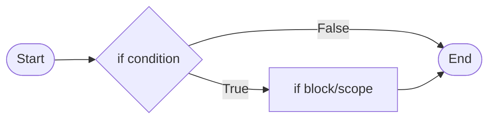

The `if` block only executes when the condition holds true; otherwise, control skips straight past it. The general code structure looks like this:
```java title:"General structure"
public class Sample1 {
    public static void main(String[] args) {
        if (condition) {
            // True block
        }
    }
}
```

**Example — print "num1 is greater" if the first number is bigger:**
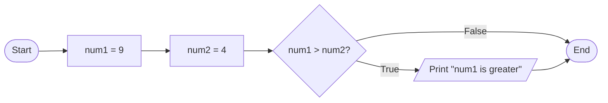

```java title:"Sample2 — print if num1 is greater"
public class Sample2 {
    public static void main(String[] args) {
        int num1 = 9;
        int num2 = 4;
        if (num1 > num2) {
            System.out.println("num1 is greater");
        }
    }
}
```
Output: `num1 is greater`

---
# 7.2 - `If - Else` Double Selection Statement
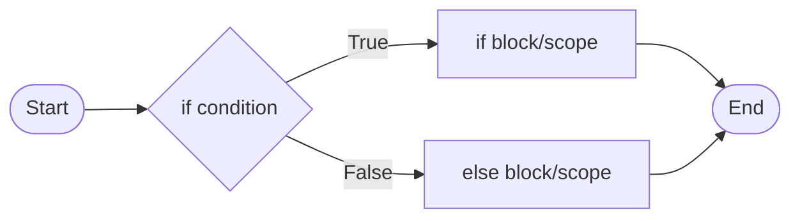

The `if` block runs only when the condition is true; the `else` block runs only when it's false.
```java title:"General structure"
public class Sample3 {
    public static void main(String[] args) {
        if (condition) {
            // True block
        }
        else {
            // False block
        }
    }
}
```

**Example — print whichever of num1/num2 is greater:**

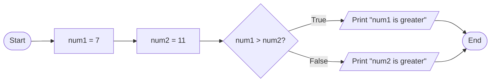

```java title:"Sample4 — print the larger number"
public class Sample4 {
    public static void main(String[] args) {
        int num1 = 7;
        int num2 = 11;
        if (num1 > num2) {
            System.out.println("num1 is greater");
        }
        else {
            System.out.println("num2 is greater");
        }
    }
}
```
Output: `num2 is greater`

Logical operators can be combined with `if` conditions whenever multiple checks need to be evaluated together.
**Example — check whether a user-entered number is a positive even number:**

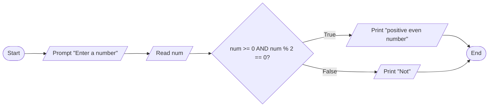

```java title:"Sample5 — positive even number check"
import java.util.Scanner;
public class Sample5 {
    public static void main(String[] args) {
        Scanner sc = new Scanner(System.in);
        int num = sc.nextInt();
        if (num >= 0 && num % 2 == 0) {
            System.out.println("positive even number");
        }
        else {
            System.out.println("not");
        }
    }
}
```
Input: `18` → Output: `positive even number`

---
# 7.3 - `If - Else If - Else` Multiple Selection Statement
When a decision depends on more than two outcomes, conditions can be chained: `if ... else if ... else if ... else`. Evaluation runs top-down — the `if` condition is checked first; if it's false, the next `else if` is checked, and so on. If none of the `else if` conditions match, the final `else` block runs automatically. As soon as one condition in the chain evaluates to true, its block executes and every condition below it in the chain is skipped.
An `if` block may be followed by any number of `else if` blocks and an optional final `else` block.

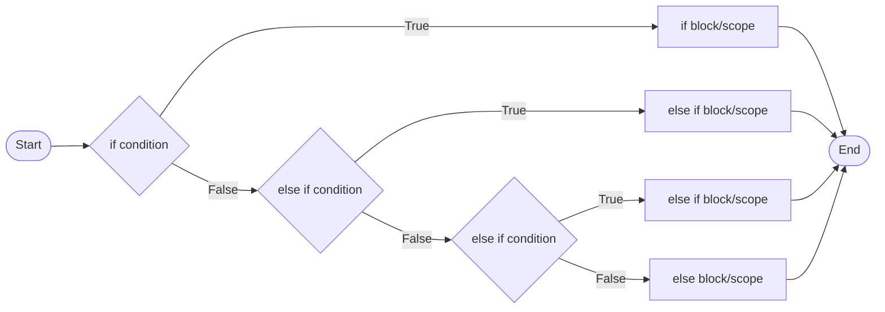

```java title:"General structure"
public class Sample6 {
    public static void main(String[] args) {
        if (condition) {
            // if True block
        }
        else if (condition) {
            // else if True block
        }
        else if (condition) {
            // else if True block
        }
        else {
            // else block
        }
    }
}
```
Only `else` and `else if` blocks require a preceding `if` block to attach to — a lone `if` block is valid on its own, and an `if` followed by one or more `else if` blocks is valid without a final `else`. But `else`/`else if` can never appear without an initial `if`.

**Example — calculate a bonus based on years of experience:**
- Over 8 years → 15% bonus
- 5–8 years → 10% bonus
- 2–4 years → 5% bonus
- Under 2 years → 2.5% bonus

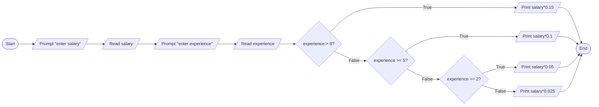

```java title:"Sample7 — experience-based bonus"
import java.util.Scanner;
public class Sample7 {
    public static void main(String[] args) {
        Scanner sc = new Scanner(System.in);
        int salary = sc.nextInt();
        int experience = sc.nextInt();
        if (experience > 8) {
            System.out.println(salary * 0.15);
        }
        else if (experience >= 5) {
            System.out.println(salary * 0.1);
        }
        else if (experience >= 2) {
            System.out.println(salary * 0.05);
        }
        else {
            System.out.println(salary * 0.025);
        }
    }
}
```
Input: `30000`, `3` → Output: `1500.0`

---
# 7.4 - Nested Decision Making
An `if...else if...else` chain can itself be placed inside another `if`, `else if`, or `else` block — these are called nested blocks. An inner block only runs if its outer conditional evaluated to true. Indentation becomes especially important here to keep nested blocks visually distinct.

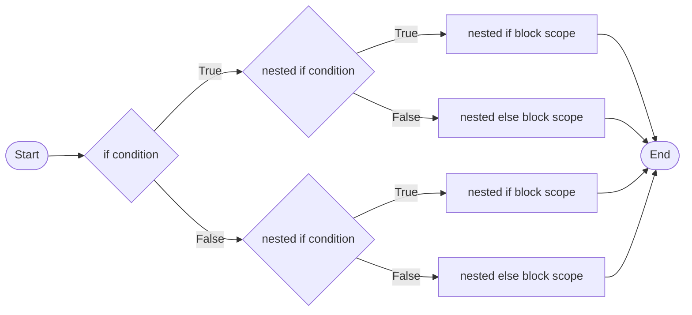

```java title:"General structure"
public class Sample8 {
    public static void main(String[] args) {
        if (condition) {
            if (condition) {
                // nested True block
            }
            else {
                // nested False block
            }
        }
        else {
            if (condition) {
                // nested True block
            }
            else {
                // nested False block
            }
        }
    }
}
```

Each nested `if`/`else` follows its own indentation and obeys the same rules as any standalone `if...else if...else` chain.

**Example — classify a number as an even multiple of 3, an odd multiple of 3, or invalid:**
*(This can also be solved with the `&&` operator and a flat `if...else if...else` chain — worth trying both ways.)*

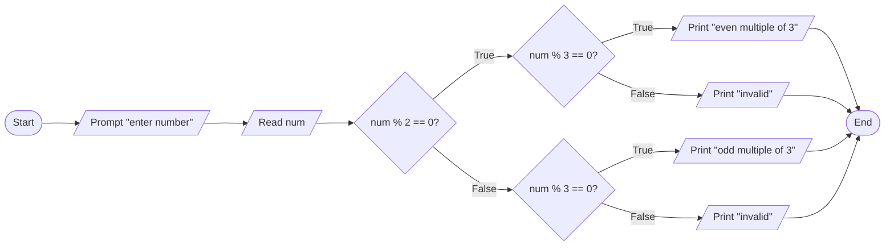

```java title:"Sample9 — even/odd multiple of 3"
import java.util.Scanner;
public class Sample9 {
    public static void main(String[] args) {
        Scanner sc = new Scanner(System.in);
        int num = sc.nextInt();
        if (num % 2 == 0) {
            if (num % 3 == 0) {
                System.out.println("even multiple of 3");
            }
            else {
                System.out.println("invalid");
            }
        }
        else {
            if (num % 3 == 0) {
                System.out.println("odd multiple of 3");
            }
            else {
                System.out.println("invalid");
            }
        }
    }
}
```
Input: `33` → Output: `odd multiple of 3`

---
# 7.5 - Switch Case Conditioning
The `switch` statement is an alternative to long `if...else if...else` chains, and reads more clearly when a single value is being compared against several fixed possibilities.

```java title:"Syntax"
switch (expression) {
    case value1:
        // Code Statements
        break; // optional
    case value2:
        // Code Statements
        break; // optional
    // ...
    case valueN:
        // Code Statements
        break; // optional
    default: // optional
        // Default Code Statements
}
```

- A switch can have one or more `case` values; `expression` is evaluated once and compared against each of them.
- Case values must match the type of `expression` — variables aren't allowed as case values — and every case value must be unique; duplicates cause a compile error.
- When `expression` matches a case value, that case's block executes. If it matches `value1`, the code under `case value1` runs, and so on.
- `break` is optional and ends the switch block. Without it, execution "falls through" into the next case regardless of whether that case matches.
- `default` is optional and runs when no case matches. It can be placed anywhere in the switch block, but if it isn't last, it needs its own `break` to avoid falling through into the next case.

In short: `switch` evaluates an expression once, jumps to the matching case, and `break` is what stops it from continuing into subsequent cases.

---
## 7.6 - Flowcharts
A few more worked examples, shown as flowcharts alongside their logic.

**Scenario 1 — determine whether a number is even or odd.**
*Hint: an even number always leaves remainder 0 when divided by 2.*

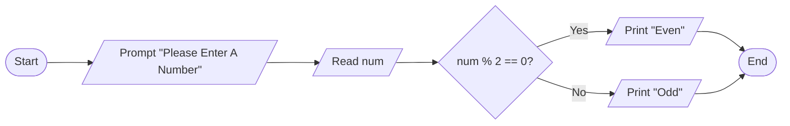

**Scenario 2 — find the largest of three unique numbers A, B, and C.**

Before drawing the flowchart, break the problem into conditions:
- If A is greater than B **and** A is greater than C, A is the largest.
- If A is not greater than B (meaning B is greater than A) and B is greater than C, B is the largest.
- If neither of the above holds, C must be the largest.

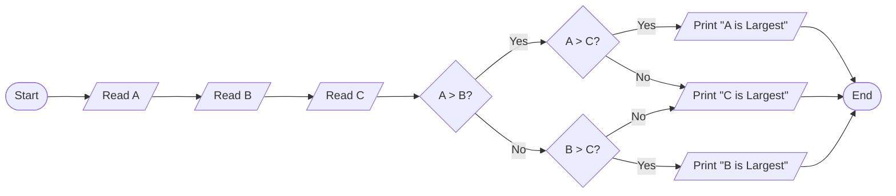

**Scenario 3 — calculate tax based on salary.**
- Salary below 20,000 Taka → no tax
- Salary 30,000 Taka or above → 10% tax
- Salary 20,000 Taka up to (but under) 30,000 Taka → 5% tax

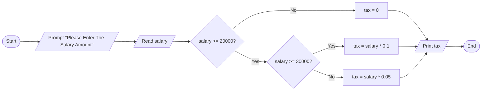

