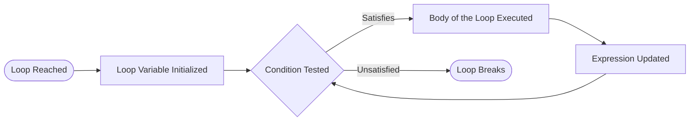
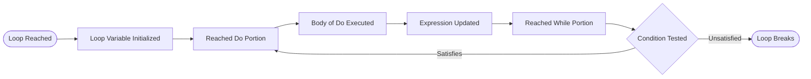
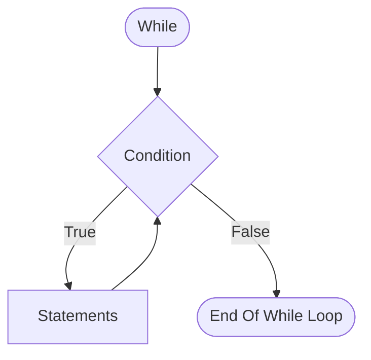

 ## 8.1 Introducing Loops
A loop (repetition) lets a block of code run multiple times without writing it out repeatedly. Anywhere a task is performed over and over — printing a sequence, accumulating a sum, validating input — a loop reduces what would otherwise be many repeated statements into a compact, controlled block.

```java title:"Without a loop — printing the first 50 even numbers"
System.out.println(0);
System.out.println(2);
System.out.println(4);
// ... 47 more lines
System.out.println(98);
```
```java title:"With a loop — same result"
int num = 0;
for (int i = 1; i <= 50; i++) {
    System.out.println(num);
    num = num + 2;
}
```

Every loop structure is built from four parts:
- **Initialization Expression(s)** — declares and sets the starting value of the variable(s) controlling the loop.
- **Test Expression (Condition)** — evaluated before/after each iteration; the loop continues only while this evaluates to `true`.
- **Body of the Loop** — the statement(s) that repeat on each iteration.
- **Update Expression(s)** — modifies the controlling variable each iteration. Omitting this causes the test expression to always hold, resulting in an **infinite loop** that never terminates on its own.

Java has three loop constructs: `while`, `for`, and `do-while`. `while` and `for` are **entry-controlled** — the condition is checked *before* the body runs, so the body may execute zero times. `do-while` is **exit-controlled** — the body always runs at least once before the condition is checked.

---
## 8.2 While Loop and For Loop
`while` and `for` behave identically in execution order; they differ only in syntax layout.

**Execution order:**
1. Control reaches the loop.
2. The condition is tested.
3. If `true`, the flow enters the body of the loop, executes it, then updates the expression, and returns to step 2.
4. If `false`, the loop breaks and control moves to the line immediately after the loop.



**While loop structure:**
```java
initialization_expression;
while (test_expression) {
    body_of_the_loop;
    update_expression;
}
```
```java title:"Example — count from 1 to 3"
int count = 1;
while (count < 4) {
    System.out.println(count);
    count = count + 1;
}
```
Output: `1 2 3`

**For loop structure:**
```java
for (initialization_expression; test_expression; update_expression) {
    body_of_the_loop;
}
```
```java title:"Example — count from 1 to 3"
for (int i = 1; i < 4; i++) {
    System.out.println(i);
}
```
Output: `1 2 3`

The initialization expression doesn't have to sit inside the `for` statement — it can be declared before the loop starts. Likewise, the update expression can be moved into the body instead of the header:
```java
int i = 1;
for ( ; i < 4; ) {
    System.out.println(i);
    i++;
}
```
Because the test expression is checked *before* the body runs, both `while` and `for` are entry-controlled — it's entirely possible for the body to never execute if the condition is false from the start.

---
## 8.3 Do-While Loop
`do-while` guarantees the body runs at least once, since the condition isn't checked until *after* the first execution — making it exit-controlled rather than entry-controlled. The `do` portion executes the body; the `while` portion then tests whether it should run again.

**Execution order:**
1. Control reaches the `do` portion.
2. The body of the loop executes.
3. The expression updates.
4. Control reaches the `while` portion and the condition is tested.
5. If `true`, flow re-enters the body (step 2).
6. If `false`, the loop breaks and control moves past the loop.



**Structure:**
```java
initialization_expression;
do {
    body_of_the_loop;
    update_expression;
} while (test_expression);
```
```java title:"Condition true — runs multiple times"
int x = 1;
do {
    System.out.println(x);
    x++;
} while (x < 5);
```
Output: `1 2 3 4`

```java title:"Condition false from the start — still runs once"
int x = 1;
do {
    System.out.println(x);
    x++;
} while (x < 1);
```
Output: `1` — the body executes once regardless of the condition, since it isn't evaluated until after that first pass.

---
## 8.4 Infinite Loop
An infinite loop runs forever because its test expression is never falsified — typically the result of forgetting to update the controlling variable. This is a common source of unintentional bugs, though infinite loops with a `break` are also a deliberate technique for indefinite repetition (see 8.7).

| Loop Type | Example |
|---|---|
| While | `while (true) { System.out.println(5); }` |
| While | `int x = 1; while (x > 0) { System.out.println(5); x += 1; }` — condition never becomes false |
| While | `int x = 1; while (x > 0) { System.out.println(5); }` — `x` never updates |
| For | `for (int i = 1; i > 0; i++) { System.out.println(5); }` |
| For | `for (int i = 1; i > 0; ) { System.out.println(5); }` — no update expression |
| For | `for ( ; ; ) { System.out.println(5); }` — all three expressions omitted |

---
## 8.5 "Break" and "Continue" Keywords
`break` stops the loop entirely, before all iterations complete. `continue` skips the remainder of the current iteration and moves straight to the next one.

```java title:"break — stops the loop once count reaches 3"
int count = 1;
while (count < 5) {
    System.out.println(count);
    count++;
    if (count == 3) {
        break;
    }
}
```
Output: `1 2` — after the second iteration, `count` becomes `3` and the loop breaks before printing again.

```java title:"continue — skips the third iteration"
for (int i = 1; i < 5; i++) {
    if (i == 3) {
        continue;
    }
    System.out.println(i);
}
```
Output: `1 2 4` — iteration `3` is skipped, but the loop continues afterward.

```java title:"continue and break combined"
for (int i = 1; i < 10; i++) {
    if (i == 3) {
        continue;
    }
    if (i > 3) {
        break;
    }
    System.out.println(i);
}
```
Output: `1 2` — iteration `3` is skipped via `continue`, then the loop breaks entirely once `i` exceeds `3`.

In nested loops, `break` and `continue` only affect the loop they're directly written inside — not any outer loop.

---
## 8.6 Nested Loops
A nested loop is a loop placed inside the body of another loop. The inner loop runs to completion for every single iteration of the outer loop.

```java title:"Count the number of divisors of each number from 1 to 10"
class DivisorCount {
    public static void main(String[] args) {
        for (int num = 1; num <= 10; num++) {
            int div = 0;
            for (int i = 1; i <= num; i++) {
                if (num % i == 0) {
                    div++;
                }
            }
            System.out.println(num + " has " + div + " divisor(s)");
        }
    }
}
```
Output:
```
1 has 1 divisor(s)
2 has 2 divisor(s)
3 has 2 divisor(s)
4 has 3 divisor(s)
5 has 2 divisor(s)
6 has 4 divisor(s)
7 has 2 divisor(s)
8 has 4 divisor(s)
9 has 3 divisor(s)
10 has 4 divisor(s)
```
Here the inner loop counts the divisors of a single number; the outer loop repeats that process for every number from 1 to 10 — two dependent repetitive tasks, which is what makes this nested rather than sequential.

**`break` and `continue` inside a nested loop:**
```java
class A {
    public static void main(String[] args) {
        for (int x = 1; x <= 5; x++) {
            for (int i = 1; i <= x; i++) {
                if (x == 1) {
                    continue;
                }
                if (x == 4) {
                    break;
                }
                System.out.println(i);
            }
        }
    }
}
```
Output: `1 2 1 2 3 1 2 3 4 5`

`continue` fires when `x == 1`, skipping that pass of the *inner* loop only. `break` fires when `x == 4`, exiting the *inner* loop only — the outer loop keeps incrementing `x` regardless. Neither keyword touches the outer loop, since both are written inside the inner one.

---
## 8.7 Definite vs Indefinite Repetition
A loop is **definite** when the number of iterations is known ahead of time, so it can be written to run a fixed number of times. A loop is **indefinite** when the number of iterations isn't known in advance — this is typically handled with an infinite loop paired with a `break` once the exit condition is met.

| | Definite | Indefinite |
|---|---|---|
| **Problem** | Print all even numbers from 1 to 10 | Print the first five numbers divisible by 3 within 1–25 |
| **Code** | `for (int i = 1; i <= 10; i++) { if (i % 2 == 0) { System.out.println(i); } }` | `int num = 0; for (int i = 1; i <= 25; i++) { if (i % 3 == 0) { System.out.println(i); num++; } if (num == 5) { break; } }` |
| **Output** | `2 4 6 8 10` | `3 6 9 12 15` |

```java title:"Indefinite — keep taking input until an even positive number is entered"
Scanner sc = new Scanner(System.in);
while (true) {
    int num = sc.nextInt();
    if (num % 2 == 0 && num > 0) {
        System.out.println(num);
        break;
    }
}
```
Input: `5`, `0`, `-4`, `6` → Output: `6` — the loop has no fixed number of iterations; it runs until the exit condition is satisfied, however many attempts that takes.

---
## 8.8 Flowcharts
A `while` loop's flowchart checks the condition first. If satisfied, the flow enters the loop, executes the statements, and returns to re-check the condition — repeating until the condition is no longer satisfied, at which point the flow exits.



---
## 8.9 Worksheet
### Flowchart Problems
**A.** Draw the flowchart of a program that calculates the sum of all the numbers from 1 to 100 using a while loop.

**B.** Draw the flowchart of a program that prompts the user to enter a password. Keep asking for the password until the user enters the correct password `"abc123"`. Once the correct password is entered, display a message `"Access granted!"`.

**C.** Draw the flowchart of a program that prompts the user to enter a positive integer and then prints all the even numbers from 2 up to and including that number.

**D.** Draw the flowchart of a program that prompts the user to enter a series of numbers. Continue reading numbers until the user enters a negative number. Then calculate and display the average of all the positive numbers entered.

### Coding Problems
**A.** Write a program that asks the user to enter a series of numbers and calculates their average. Display the average to the user.

**B.** Write a program that prompts the user to enter a positive integer and prints the factorial of that number.

**C.** Write a program that prints the multiplication table for a given number from 1 to 10.

**D.** Write a program that prints the ASCII values and characters for all uppercase letters (A-Z) using a loop.

**E.** Write a program that prompts the user to enter a positive integer and checks if it is a prime number. Display an appropriate message indicating whether the number is prime or not.

**F.** Write a program that prompts the user to enter a positive integer and checks if it is a perfect number. Display an appropriate message indicating whether the number is perfect or not.

**G.** Write a program that prompts the user to enter a positive integer and checks if it is a palindrome number. A number is a palindrome if it reads the same forwards and backwards. Display an appropriate message indicating whether the number is a palindrome or not.
