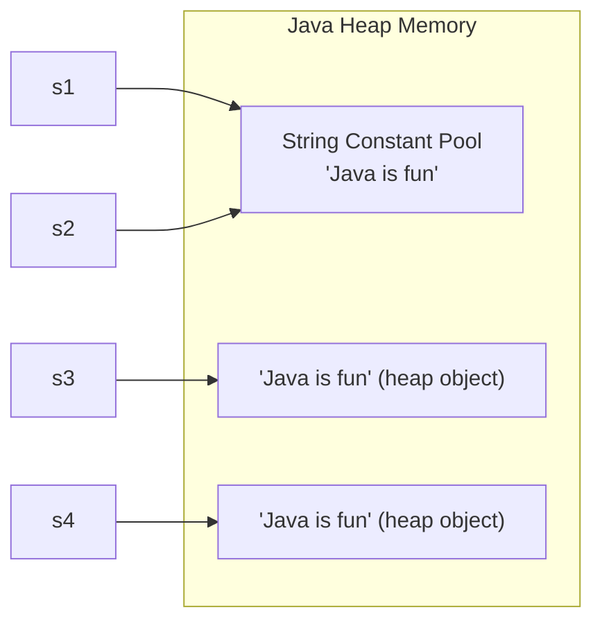

# 9.1 Declaration and Initialization
Strings are sequences of characters, but in Java, strings are implemented as **objects**, not primitives. There are two ways to create a string in Java.

**1. String literal** — a new string object is created using double quotation marks:
```java
String str1 = "Hello world!";
String empty_str = ""; // this is an empty string
```
Creating a string this way is more memory-efficient because Java checks the **string constant pool** before creating a new object. If the string already exists in the pool, only a reference to it is returned; a new object is created only if it doesn't already exist. The string constant pool can be thought of as a special reserved area of memory.

**2. `new` keyword** — a new string object is created using one of the `String` class constructors. There are 13 constructors in the `String` class; the most common are shown below:
```java
String str2 = new String("Hello world!");
String empty_str = new String(); // this is an empty string
char[] character_array = {'H','e','l','l','o',' ','w','o','r','l','d','!'};
String str3 = new String(character_array);
```
Using `new` creates a brand-new `String` object every time, stored in **heap memory** — it does not check the constant pool.

```java title:"Example — how these are stored"
String s1 = "Java is fun";
String s2 = "Java is fun";
String s3 = new String("Java is fun");
String s4 = new String("Java is fun");
```

When `s1` is created, `"Java is fun"` doesn't yet exist in the pool, so it's added there. When `s2` is created, the same literal already exists in the pool, so its reference is returned instead of creating a new object — this is why `s1` and `s2` point to the exact same object. `s3` and `s4`, however, are created with the `String` constructor, so each one creates a **separate** object in the heap, even though the content is identical.

---
## 9.2 String Input
The `Scanner` class must be imported to take string input from the user.
```java
import java.util.Scanner;
class Main {
    public static void main(String[] args) {
        Scanner sc = new Scanner(System.in);
        String user_input = sc.nextLine();
        System.out.println(user_input);
    }
}
```
`sc.nextLine()` is used for string input because it reads everything up to (and includi ng consuming) the next newline character (`\n`), rather than stopping at whitespace like `next()` would.

---
## 9.3 String Escape Sequence
To include quotation marks *inside* a string, an escape sequence (`\`) is required.
```java
String s = "I love \'Java\' very much";
System.out.println(s);
```
**Output:** `I love 'Java' very much`

The same applies in reverse — if the outer string uses single quotes conceptually, escape the double quotes with `\"` instead.

---
## 9.4 String Length
The `length()` method returns the number of characters in a string.
```java
String s = "I love Java";
System.out.println(s.length());
```
**Output:** `11` — there are 11 characters in the string, including the space.

---
## 9.5 String Indexing
Each character in a string can be accessed by its position, called an **index**. Indexing starts at `0` and runs to `length() - 1`.

```
String s = "Programming is fun";
```
| Index | 0 | 1 | 2 | 3 | 4 | 5 | 6 | 7 | 8 | 9 | 10 | 11 | 12 | 13 | 14 | 15 | 16 | 17 |
|---|---|---|---|---|---|---|---|---|---|---|---|---|---|---|---|---|---|---|
| Char | P | r | o | g | r | a | m | m | i | n | g | (space) | i | s | (space) | f | u | n |

The first character is always at index `0`; the last is always at index `length() - 1`.

The `charAt()` method retrieves the character at a given index:
```java
String s = "Programming is fun";
char first_character = s.charAt(0);
char last_character = s.charAt(s.length() - 1);
char random = s.charAt(10);
System.out.println(first_character); // P
System.out.println(last_character);  // n
System.out.println(random);          // g
```

---
## 9.6 Character Array
A string can be converted into an array of its individual characters using `toCharArray()`.
```java
String s = "This is a string";
char[] char_array = s.toCharArray();
System.out.println(char_array);
```
Each element of `char_array` corresponds to one character of the original string, indexed the same way as the string itself.

---
## 9.7 Mutability of Strings
Strings in Java are **immutable** — once created, the characters that make up a string object cannot be changed. Any operation that appears to "modify" a string (like `replace()` or `toUpperCase()`) actually creates and returns a **new** string object containing the result, leaving the original untouched.

---
## 9.8 String Concatenation
Multiple strings can be joined using the `+` operator — this is called **concatenation**, and it produces a new string.
```java
String s1 = "I love Java ";
String s2 = "programming ";
String s3 = s1 + s2 + "very much";
System.out.println(s3);
```
**Output:** `I love Java programming very much`

When a non-string operand appears alongside a string operand in a `+` expression, Java automatically converts that operand to its string representation before concatenating:
```java
String s1 = "CSE";
int num = 110;
String output = s1 + num;
System.out.println(output);
```
**Output:** `CSE110`

**Operator precedence matters** in mixed expressions — evaluation proceeds left to right:
```java
String semester = "Fall ";
int y1 = 20;
String output = semester + y1 + 23;
System.out.println(output);
```
**Output:** `Fall2023` — `"Fall " + 20` becomes the string `"Fall 20"` first, then `+ 23` appends `"23"` to give `"Fall 2023"`.

Had the expression instead been `y1 + 23 + semester`, the integers `y1` and `23` would be added arithmetically first (`43`), and only then concatenated to the string, producing `"43Fall "`.

---
## 9.9 Comparing Strings
**`equals()`** — checks whether the *content* of two strings is identical. Returns `true` if both strings contain the same characters in the same order, `false` otherwise.
```java
String s1 = "Let us code";
String s2 = "Java";
String s3 = "Let us code";
System.out.println(s1.equals(s2)); // false
System.out.println(s1.equals(s3)); // true
```
`equals()` is case-sensitive — `"Let us code"` and `"Let us Code"` would return `false`. Use `equalsIgnoreCase()` if case should be ignored.

**`==` operator** — checks whether two string variables reference the *same object in memory*, not whether their contents match.
```java
String s1 = new String("Let us code");
String s2 = new String("Let us code");
System.out.println(s1.equals(s2)); // true  — same content
System.out.println(s1 == s2);      // false — different objects in heap memory
```

**`compareTo()`** — compares two strings lexicographically (dictionary order, based on Unicode values). Returns:
- `0` if the strings are identical
- a **positive** integer if the calling string is lexicographically greater
- a **negative** integer if the calling string is lexicographically smaller

```java
String s1 = "Java";
String s2 = "Java";
String s3 = "Jade";
String s4 = "Lava";
System.out.println(s1.compareTo(s2)); // 0
System.out.println(s1.compareTo(s3)); // 18  — 'v' is 18 more than 'd'
System.out.println(s1.compareTo(s4)); // -2  — 'J' is 2 less than 'L'
```

---
## 9.10 Searching a Character in a String
- **`indexOf()`** — returns the index of the *first* occurrence of a character/substring.
- **`lastIndexOf()`** — returns the index of the *last* occurrence of a character/substring.

```java
String s1 = "random string";
System.out.println(s1.indexOf('n'));      // 2
System.out.println(s1.lastIndexOf('n'));  // 11
System.out.println(s1.indexOf("ring"));   // 9
```

---
## 9.11 String Slicing
The `substring()` method extracts part of a string.
- With one argument (`start_index`): returns everything from `start_index` to the end of the string.
- With two arguments (`start_index`, `end_index`): returns the substring from `start_index` up to — but **not including** — `end_index`.

```java
String s1 = "Java Programming is fun";
String sub1 = s1.substring(5);
String sub2 = s1.substring(5, 12);
System.out.println(sub1); // Programming is fun
System.out.println(sub2); // Program
```
Note that `end_index` is **exclusive** — the substring stops right before that index.

---
## 9.12 Modifying a String
Since strings are immutable, "modifying" one always means producing a new string. The `replace()` method creates a new string with all occurrences of a target character/substring swapped for a replacement.
```java
String s1 = "marathon";
String new_s1 = s1.replace("a", "e");
String new_s2 = s1.replace("mara", "py");
System.out.println(new_s1); // merethon
System.out.println(new_s2); // python
```

---
## 9.13 Trimming and Splitting a String
**`trim()`** — removes leading and trailing whitespace, returning a new string.
```java
String s1 = "   Java   ";
String s2 = s1.trim();
System.out.println(s2); // Java
```

**`split()`** — breaks a string into a `String` array using a given delimiter.
```java
String s1 = "Java is fun";
String[] s1_array = s1.split(" ");
// s1_array = {"Java", "is", "fun"}

String s2 = "Java,is,,fun";
String[] s2_array = s2.split(",");
// s2_array = {"Java", "is", "", "fun"}
```

---
## 9.14 Case Conversion
**`toLowerCase()`** — converts all uppercase letters in a string to lowercase, returning a new string.
```java
String s1 = "Java Programming is FUN";
String lower_s1 = s1.toLowerCase();
System.out.println(lower_s1); // java programming is fun
```

**`toUpperCase()`** — converts all lowercase letters to uppercase, returning a new string.
```java
String s2 = "i love to CODE";
String upper_s2 = s2.toUpperCase();
System.out.println(upper_s2); // I LOVE TO CODE
```

---
## 9.15 Data Conversion in Strings
**`valueOf()`** — a static `String` class method used to convert other datatypes into their `String` representation.
```java
int digit = 85;
float decimal = 54.643F; // F marks a float literal
char letter = 'A';

String s1 = String.valueOf(digit);
String s2 = String.valueOf(decimal);
String s3 = String.valueOf(letter);
System.out.println(s1); // "85"
System.out.println(s2); // "54.643"
System.out.println(s3); // "A"
```

---
## 9.16 ASCII Values
Every keyboard character has a unique Unicode value (see the [ASCII table](https://www.cs.cmu.edu/~pattis/15-1XX/common/handouts/ascii.html)). The **`codePointAt()`** method takes an index and returns the Unicode value of the character at that position.
```java
String s1 = "Hello World!";
int unicode_val = s1.codePointAt(0);
System.out.println(unicode_val); // 72 — Unicode value of 'H'
```

Unicode values can also be used to convert between uppercase and lowercase manually. Uppercase `'A'` is `65`, lowercase `'a'` is `97` — a difference of `32` across the entire alphabet. Adding `32` to an uppercase letter's Unicode value gives the lowercase equivalent (and subtracting `32` reverses it); casting the resulting int back with `(char)` produces the actual character.
```java
String upper_s1 = "CODE";
int unicode_upper = upper_s1.codePointAt(2); // 'D' → 68
int unicode_lower = unicode_upper + 32;      // 100
char lower_letter = (char) unicode_lower;
System.out.println(lower_letter); // d
```

---
## 9.17 Checking Substring Existence
**`contains()`** — checks whether a substring exists within a string. Returns `true`/`false`, and is case-sensitive.
```java
String s1 = "I love Java programming";
boolean res1 = s1.contains("Java");     // true
boolean res2 = s1.contains("love Java "); // true
boolean res3 = s1.contains("p");        // true
boolean res4 = s1.contains("java");     // false — case-sensitive
```

---
## 9.18 Worksheet

**A.** Write a Java program that takes a string as input and reverses it.
Sample input: `Programming` → Sample output: `gnimmargorP`


**B.** Write a Java program that takes a string as input and counts the number of vowels (a, e, i, o, u) present in the string.
Sample input: `Programming` → Sample output: `3`

**C.** Write a Java program that takes a string as input and checks if it is a palindrome (reads the same backward as forward). Output `"Palindrome"` or `"Not a Palindrome"`.
Sample input 1: `ABCDCBA` → Sample output 1: `Palindrome`
Sample input 2: `Nepal` → Sample output 2: `Not a Palindrome`

**D.** Write a program that takes a string as input and returns the number of characters in it.
Sample input: `Programming` → Sample output: `11`

**E.** Input a word into a String. Print each character on a line by itself.
Sample input: `Program` → Sample output:
```
P
r
o
g
r
a
m
```

**F.** Input a word into a String. Print the Unicode code for each character using the 2nd method discussed above (`codePointAt()`). The whole program may contain the word `"String"` at most two times.
Sample input: `Pro` → Sample output:
```
P : 80
r : 114
o : 111
```

**G.** Print the statistics of occurrence of each character on a line by itself. Assume the user only enters CAPITAL letters, so only capital letters need to be counted.
Sample input: `BALL` → Sample output:
```
A which is 65 was found 1 time(s)
B which is 66 was found 1 time(s)
L which is 76 was found 2 time(s)
```

**H.** Input a word into a String.
- Print the word.
- Print the word again after appending `"==THE END=="` to the end.
- Print the (original) word again.
The whole program may contain the word `"String"` at most two times.
Sample input: `Programming` → Sample output:
```
Programming
Programming==THE END==
Programming
```

**I.** Answer the following theoretical questions:
- What is string immutability in Java? Explain why strings are immutable, and discuss the advantages and disadvantages of immutability.
- Discuss the significance of the `equals()` method versus the `==` operator when comparing strings in Java.
- What is the purpose of the `substring()` method in Java? Explain how it can be used to extract substrings from a larger string.
- Describe the process of converting a string to a numeric value in Java. Explain the use of `parseInt()` and `valueOf()` for this purpose.
- What are some common methods available in the `String` class in Java? Provide examples of how these methods can be used.
