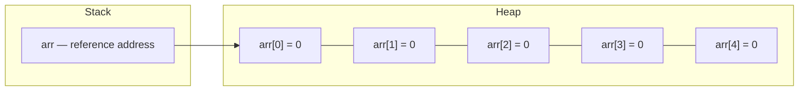

# 10.1 Properties
An array stores multiple values of the same type in a single variable, instead of declaring a separate variable for each value — a fixed-size collection of similar elements. For example, storing the names of 40 students would normally need 40 separate `String` variables; an array of type `String` can hold all 40 in one variable.

Any type can be stored in an array — primitives (`int`, `double`, `boolean`, etc.) as well as object types like `String`. Arrays can also be multi-dimensional, meaning they can represent rows and columns. An array's length is fixed at the moment it is constructed and cannot be changed afterward. Arrays are index-based: the first element sits at index 0, the second at index 1, and so on.

| Index   | 0   | 1   | 2   | 3   | 4   | 5   | 6   | 7   | 8   | 9   |
| ------- | --- | --- | --- | --- | --- | --- | --- | --- | --- | --- |
| Element | 44  | 60  | 51  | 21  | 65  | 92  | 15  | 89  | 32  | 70  |
Array Length = 10 (first element at index 0, last element at index 9 = length − 1)

---
# 10.2 Declaration, Creation, and Initialization
Making an array involves three distinct steps:
- Declare the array name
- Create the array (allocate memory)
- Initialize the array values

**Declaration** — the general form is:
```java
data_type variableName[];
```
```java
int quiz_marks[];
```
This declares `quiz_marks` as an array variable of type `int`, but no actual array exists in memory yet.

**Creation** — to link the variable to an actual array, memory must be allocated with the `new` keyword:
```java
quiz_marks = new int[5];
```
`new` is the operator that allocates memory for arrays. Here, `5` defines the array's length — it can now store five elements.

**Short form** — declaration and creation combined in a single line:
```java
int[] total_marks = new int[5];
```
When an array is created, all its elements are automatically set to a default value based on the datatype:

| Data Type | Default Value                 |
| --------- | ----------------------------- |
| byte      | 0                             |
| short     | 0                             |
| int       | 0                             |
| long      | 0                             |
| float     | 0.0                           |
| double    | 0.0                           |
| boolean   | false                         |
| char      | `'\u0000'` (Unicode for null) |
| String    | null                          |
| Object    | null                          |

**Memory model** — the stack is temporary memory; after `new` is used, the actual array is stored in the heap. The array variable itself (in the stack) only holds a reference — the address pointing to where the real array lives in the heap.



**Declaration and creation with different datatypes:**
```java
int[] a1 = new int[5];       // {0, 0, 0, 0, 0}
double[] a1 = new double[5]; // {0.0, 0.0, 0.0, 0.0, 0.0}
float[] a1 = new float[5];   // {0.0, 0.0, 0.0, 0.0, 0.0}
String[] a1 = new String[5]; // {null, null, null, null, null}
```

Constructing an array is therefore two steps: declare a variable of the desired type, then use `new` to allocate the memory and assign it to that variable. Default values are then assigned automatically according to the datatype.

**Inserting elements** — the general syntax for placing a value at a specific index is:
```java
array_name[index_number] = element;
```

### Ways to initialize an array

| Process | Description | Code |
|---|---|---|
| Dynamically, one by one | Assign each index individually after creation. | `int a[] = new int[3];`<br>`a[0] = 1;`<br>`a[1] = 2;`<br>`a[2] = 3;` |
| At the time of declaration | Provide the values in curly braces on the right side of the declaration. | `int a[] = {1, 2, 3, 4, 5};` |
| Using a loop | Loop from index 0 to `length - 1`, assigning a value each iteration. | `int a[] = new int[5];`<br>`for (int i = 0; i < a.length; i++) {`<br>`    a[i] = i + 1;`<br>`}` |
| Taking user input | Read values with a `Scanner` inside a loop. | `import java.util.Scanner;`<br>`Scanner sc = new Scanner(System.in);`<br>`int a[] = new int[5];`<br>`for (int i = 0; i < 5; i++) {`<br>`    a[i] = sc.nextInt();`<br>`}` |
| Random value generator | Use the `Random` class to fill the array with random integers. | `import java.util.Random;`<br>`Random rd = new Random();`<br>`int a[] = new int[5];`<br>`for (int i = 0; i < 5; i++) {`<br>`    a[i] = rd.nextInt(10);`<br>`}` |

`rd.nextInt(10)` generates a random integer between 0 (inclusive) and 10 (exclusive).

**Worked example — reading four integers into an array:**
```java
int arr[] = new int[4];
for (int i = 0; i < arr.length; i++) {
    arr[i] = sc.nextInt();
}
```
The array starts as `{0, 0, 0, 0}` since it holds `int`. The loop begins at `i = 0` (the first valid index) and continues while `i < arr.length`, since the last valid index is always `length - 1`. `arr.length` is an attribute (not a method) that returns the number of elements the array can hold — there is no separate method for array length.

| Iteration | i | User Input | Array State |
|---|---|---|---|
| 1st | 0 | 55 | `{55, 0, 0, 0}` |
| 2nd | 1 | 66 | `{55, 66, 0, 0}` |
| 3rd | 2 | 70 | `{55, 66, 70, 0}` |
| 4th | 3 | 35 | `{55, 66, 70, 35}` |

---
# 10.3 Array Iteration
Arrays store homogeneous elements — all of the same type. Beyond storing values, we also need to work with them, which requires **iteration**: accessing each element one by one.

**Accessing a single element:**
```java
String student_name[] = {"David", "Jon", "Sam", "Elsa", "Anne"};
System.out.println(student_name[0]);
```
Output: `David`

Index 0 holds the array's first element, so printing `student_name[0]` prints `"David"`.

**Copying an element into a separate variable:**
```java
String student_name[] = {"David", "Jon", "Sam", "Elsa", "Anne"};
String top_scorer = student_name[0];
System.out.println(top_scorer);
```
Output: `David`

This copies the value at index 0 into `top_scorer`. The original array is unaffected — `top_scorer` holds an independent copy.

| Task | Syntax |
|---|---|
| Print an element | `System.out.println(array_name[index_number]);` |
| Copy and print an element | `variable_name = array_name[index_number];`<br>`System.out.println(variable_name);` |

**Iterating over the whole array** — usually done with a loop. The loop starts at index 0 and continues until `arr.length - 1`:
```java
int arr[] = {42, -3, 31, 97, 15};
for (int i = 0; i < arr.length; i++) {
    System.out.println(arr[i]);
}
```
Output:
```
42
-3
31
97
15
```
The loop variable `i` doubles as the index — each iteration reads and prints `arr[i]`.

Arrays can be iterated with `for`, `while`, or `do-while` loops, depending on preference:

| Loop Type | Description | Code |
|---|---|---|
| For | Starts at 0, runs while `i < a.length`, `i` increments by 1 each pass. | `int a[] = {5, 6, 9, 8, 6};`<br>`for (int i = 0; i < a.length; i++) {`<br>`    System.out.println(a[i]);`<br>`}` |
| While | Same range as the for-loop, but the increment is written explicitly inside the loop body. | `int a[] = {5, 6, 9, 8, 6};`<br>`int i = 0;`<br>`while (i < a.length) {`<br>`    System.out.println(a[i]);`<br>`    i++;`<br>`}` |
| Do-While | `i` starts at 0; the body executes at least once before the condition is checked. | `int a[] = {5, 6, 9, 8, 6};`<br>`int i = 0;`<br>`do {`<br>`    System.out.println(a[i]);`<br>`    i++;`<br>`} while (i < a.length);` |

---
# 10.4 Operations on an Array
The following operations all use the array `int arr[] = {55, 66, 7, -2, 9};`

| Operation | Description | Code | Output |
|---|---|---|---|
| Length | Counts the total number of elements. | `System.out.println(arr.length);` | `5` |
| Traverse | Visits every element one by one — the basis for tasks like printing or processing all elements. | `for (int i = 0; i < arr.length; i++) {`<br>`    System.out.println(arr[i]);`<br>`}` | `55`<br>`66`<br>`7`<br>`-2`<br>`9` |
| Insertion | Places an element at a given index. | `int x[] = new int[5];`<br>`x[1] = 10;`<br>`System.out.println(x[1]);`<br>`for (int i = 0; i < x.length; i++) {`<br>`    System.out.println(x[i]);`<br>`}` | `10`<br>`0`<br>`10`<br>`0`<br>`0`<br>`0` |
| Deletion | Resets the element at a given index to its default value (there's no true removal — array length is fixed). | `arr[1] = 0;`<br>`for (int i = 0; i < arr.length; i++) {`<br>`    System.out.println(arr[i]);`<br>`}` | `55`<br>`0`<br>`7`<br>`-2`<br>`9` |
| Update | Overwrites the element at a given index with a new value. | `arr[1] = 65;`<br>`for (int i = 0; i < arr.length; i++) {`<br>`    System.out.println(arr[i]);`<br>`}` | `55`<br>`65`<br>`7`<br>`-2`<br>`9` |
| Copying an array | Creates a second array of the same length and datatype, then copies each element across one by one. The two arrays occupy different memory addresses, so modifying one does not affect the other. | `int arr2[] = new int[arr.length];`<br>`for (int i = 0; i < arr.length; i++) {`<br>`    arr2[i] = arr[i];`<br>`}`<br>`for (int i = 0; i < arr2.length; i++) {`<br>`    System.out.println(arr2[i]);`<br>`}` | `55`<br>`66`<br>`7`<br>`-2`<br>`9` |

*(Note: the Insertion example's expected first output line reads `10` — it prints `x[1]` immediately after assignment, before the loop runs.)*

---
# 10.5 Multidimensional Arrays
Arrays covered so far are **one-dimensional** — values sit in a single row. To represent tabular data (rows and columns), Java uses **multidimensional arrays**: arrays of arrays. The general form is:
```java
data_type[dim1][dim2]...[dimN] array_name = new data_type[size1][size2]...[sizeN];
```
Examples:
```java
int[][][] newArray = new int[10][20][30]; // three-dimensional array
int[][] numbers = { {1, 2, 3, 4}, {5, 6, 7} }; // two-dimensional array
```
Accessing or modifying a value requires one index per dimension. For `numbers[1][2]`, `[1]` selects the outer array (the second inner array, `{5, 6, 7}`), and `[2]` selects index 2 within it — giving `7`.

**Accessing values:**
```java
public class Example1 {
    public static void main(String[] args) {
        int[][] numbers = { {1, 2, 3, 4}, {5, 6, 7} };
        System.out.println(numbers[0][1]);
    }
}
```
Output: `2`

**Modifying values:**
```java
public class Example2 {
    public static void main(String[] args) {
        int[][] numbers = { {1, 2, 3, 4}, {5, 6, 7} };
        System.out.println(numbers[0][0]); // Prints 1
        numbers[0][0] = 9;
        System.out.println(numbers[0][0]); // Prints 9
    }
}
```
Output:
```
1
9
```

---
## 10.6 Worksheet

**B.** Given an array of integers, write a program to find the maximum element in the array.
```
Given Array: {5, 2, 8, 3, 9}
Sample Output: 9
```

**C.** Write a function that takes an array of integers as input and returns the sum of all the elements.
```
Given Array: {5, 2, 8, 3, 9}
Sample Output: 27
```

**D.** Write a program that takes an array and a target element as input and prints the index of the target element in the array. If not found, print "Not Found".
```
Given Array: {5, 2, 8, 3, 9}, Target: 8
Sample Output: Target element is at index: 2

Given Array: {5, 2, 8, 3, 9}, Target: 18
Sample Output: Not Found
```

**E.** Given an array of integers, write a program that prints the occurrence of each element in the array.
```
Given Array: {5, 3, 5}
Sample Output:
5 is repeated 2 time(s)
3 is repeated 1 time(s)
```

**F.** Given two arrays, write a program that prints an array containing the common elements in both arrays.
```
Given Arrays: {5, 2, 8, 3, 9} and {6, 3, 5, 11, 10}
Sample Output: {3, 5}
```

**G.** Given an array with duplicate elements, write a program that removes the duplicates and prints a new array with unique elements only.
```
Given Array: {5, 2, 8, 3, 2}
Sample Output: {5, 2, 8, 3}
```

**H.** Write a program that takes an array as input and returns a new array with the elements reversed.
```
Given Array: {1, 2, 3, 4, 5}
Sample Output: {5, 4, 3, 2, 1}
```