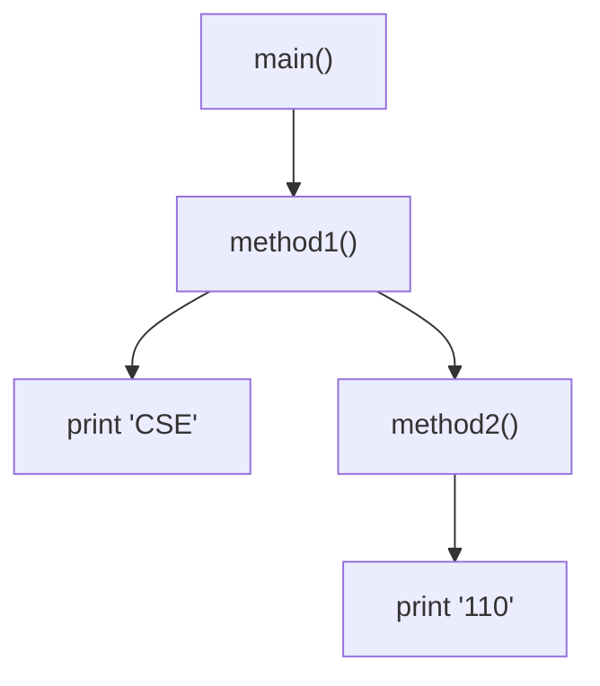

# 11.1 What Are Methods?
A method is a reusable block of code designed to perform a specific task. Once written, it can be invoked from anywhere in the program without needing to be rewritten. In other programming languages, methods are often referred to as functions.

# 11.2 Types of Methods
- **Pre-Defined / Built-In Methods** — Already implemented in Java's libraries (e.g. `.length()`, `.equals()`, `.compareTo()`, `.toLowerCase()`). These simply need to be called; the implementation is handled internally.
- **User-Defined Methods** — Written by the programmer. These must be both designed and called. The rest of this chapter focuses on how to construct them.

# 11.3 Basic Structure of a User-Defined Method
A method is composed of the following elements:

| Component                                                    | Purpose                                                                                                                                                                                                                                            |
| ------------------------------------------------------------ | -------------------------------------------------------------------------------------------------------------------------------------------------------------------------------------------------------------------------------------------------- |
| **Access Modifier** (`public`/`private`/`protected`/default) | Controls where the method can be accessed from. For now, only `public` methods are used — accessible from anywhere, inside or outside the class.                                                                                                   |
| **`static` keyword**                                         | Marks the method as belonging to the class itself rather than to an instance, meaning it can be invoked without creating an object. A static method can call other static methods directly.                                                        |
| **Return Type**                                              | Specifies the data type of the value the method sends back. If a method contains a `return` statement, the return type must match the type of the returned value. A method with no `return` statement — or one that returns nothing — uses `void`. |
| **Method Name**                                              | Should clearly describe what the method does.                                                                                                                                                                                                      |
| **Parameter Type & Name**                                    | A method may take zero or more parameters, each with a declared type and a name. Parameters exist only within the method's scope and are inaccessible outside it.                                                                                  |
| **Method Body**                                              | Contains the logic specific to the method's purpose. Any variables declared here (including parameters) are local to the method.                                                                                                                   |
| **Return Statement(s)**                                      | Ends execution of the method and sends a value back to the calling point. Once a `return` is reached, no further lines in the method execute.                                                                                                      |

None of these components are strictly mandatory in every method — for example, a method may have no parameters and no return statement, depending on what it needs to do.

```java title:"General synteax"
access_modifier static return_type method_name(parameter_type parameter_name) {
    method_body;
    return return_value;
}
```

```java title:"Labelled example"
public static int add(int a, int b) {
    int sum = a + b;
    return sum;
}
```

- `public` → access modifier
- `static` → static keyword
- `int` (before `add`) → return type
- `add` → method name
- `(int a, int b)` → parameters
- `int sum = a + b;` → method body
- `return sum;` → return value

# 11.4 Return Types — Examples
```java title:"Void return (no value sent back)"
static void print_sum(int a, int b) {
    int sum = a + b;
    System.out.println(sum);
} // this method does not return any value
```

```java title:"Int return"
static int sum(int a, int b) {
    int sum = a + b;
    return sum;
} // this method returns an integer type value
```

```java title:"Boolean return"
static boolean check(int a) {
    if (a > 10) {
        return true;
    } else {
        return false;
    }
} // this method returns a boolean type value
```

```java title:"String return"
static String okay(int a, String str1) {
    return (a + 2) + str1;
} // this method returns a String type value
```

```java title:"Double return"
static double point(int a) {
    double db = a / 10.0;
    return db;
} // this method returns a double type variable
```

# 11.5 Method Call
Designing a method is only half the job — it must also be called, or it will never execute. Key rules:
- A method call must happen from inside the `main()` method (or from within another method that is itself eventually called from `main()`).
- The number of arguments passed **must** equal the number of parameters received.
- The **order** in which arguments are passed matters — it maps directly to the parameter order.
- The **type** of each argument must match the type of the corresponding parameter.
- After the call completes, control (and any returned value) passes back to the line where the call was made.

```java title:"Example - calling add"
public static void main(String[] args) {
    int answer = add(4, 5);
    System.out.println(answer);
}
```

```
Welcome to DrJava. Working directory is E:\Java
> run function1
9
```

Here, `answer` receives the value returned by `add(4, 5)`, and `4`/`5` are passed as `int` arguments matching the declared `int a, int b` parameters.

# 11.6 Method Arguments & Parameters
The values sent during a method call are **arguments**; the variables that receive them inside the method are **parameters**. Their sequence corresponds directly — the first argument fills the first parameter, and so on.

```java
static void subtract(int a, int b) {
    int diff = a - b;
    System.out.println(diff);
} // this method does not return any value
```

```java
subtract(2, 3);   // a = 2, b = 3 → diff = 2 - 3 = -1
subtract(3, 2);   // a = 3, b = 2 → diff = 3 - 2 = 1
```

```
-1
1
```

Reversing argument order changes which value lands in which parameter — so `subtract(2, 3)` and `subtract(3, 2)` produce different results even though the same two numbers are involved.

# 11.7 Is a Return Statement Needed?
A method **must** include at least one `return` statement in these two cases:
1. The method call is assigned to a variable.
2. The method call is nested inside another user-defined or built-in method.
If either case applies and the method doesn't explicitly return a value, Java returns `null` by default — which can cause unintended errors downstream.

```java title:"No return needed - void method, call stands alone"
public class func1 {
    public static void sayHello() {
        System.out.println("Hello!");
    }
    public static void main(String[] args) {
        sayHello();   // no arguments, no parameters, result not stored
    }
}
```
```
Hello!
```

```java title:"Return required - result is stored in a variable"
public class func1 {
    public static String divThree(int num) {
        if (num % 3 == 0) {
            return "Divisible by 3";
        } else {
            return "Not divisible by 3";
        }
    }
    public static void main(String[] args) {
        String answer = divThree(13);   // 13 is passed in as num
        System.out.println(answer);     // return value is stored here
    }
}
```
```
Not divisible by 3
```

A method can contain multiple `return` statements across `if`/`else if`/`else` branches — only one branch executes per call, so only one `return` ever fires.

```java title:"Another void example - no return needed"
public class func1 {
    public static void findLargest(int num1, int num2) {
        if (num1 > num2) {
            System.out.println(num1);
        } else {
            System.out.println(num2);
        }
    }
    public static void main(String[] args) {
        findLargest(13, -10);
    }
}
```
```
13
```

# 11.8 Method Signature
- A method is identified by its **name**, **parameter list**, and **return type** combined.
- The number of arguments in a call must match the number of parameters in the declaration.
- Multiple methods can share the same name if their parameter lists differ (**method overloading**).
- Multiple methods can share both name and parameter list but differ in return type — also a form of overloading.
(Method overloading is covered in more depth in CSE111.)

# 11.9 Calling a Method from Another Method
A method can call another method from within its own body — not just from `main()`.
```java
public class Methods {
    public static void main(String[] args) {
        method1();
    }
    static void method1() {
        System.out.print("CSE");
        method2();
    }
    static void method2() {
        System.out.print("110");
    }
}
```
```
CSE110
```



`main()` calls `method1()`, which prints `"CSE"` and then calls `method2()`, which prints `"110"` — producing the combined output `CSE110`.

# 11.10 Worksheet

**A.** For each of the following, identify when it is needed and when it is not:
   a. Parameter Type
   b. Return Type
   c. Return Statements

**B.** Write a method named `evenPositive` that finds the even and positive numbers from an array of numbers.

**C.** Write a method `show_triangle()` that prints a triangular palindrome pattern:

```
1
121
12321
1234321
123454321
```

Use the helper methods `show_spaces()` and `show_palindrome()` (already implemented) to build it.

```java
public class MethodCalling {
    public static void main(String[] args) {
        show_triangle(4);
        System.out.println();
        show_triangle(5);
    }

    static void show_spaces(int a) {
        for (int i = 0; i < a; i++) {
            System.out.print(" ");
        }
    }

    static void show_palindrome(int b) {
        for (int i = 1; i <= b; i++) {
            System.out.print(i);
        }
        for (int i = b - 1; i >= 1; i--) {
            System.out.print(i);
        }
    }

    static void show_triangle(int a) {
        // To Do
    }
}
```
