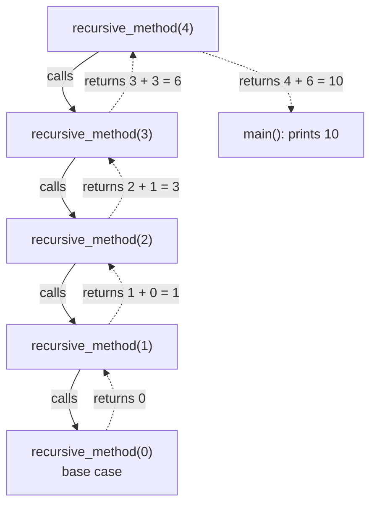
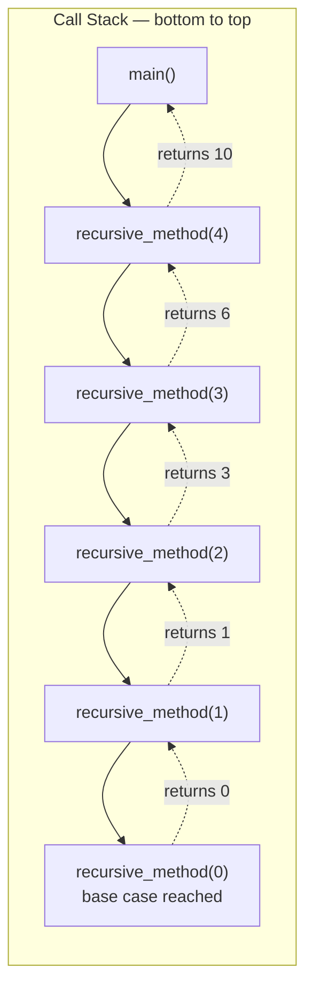
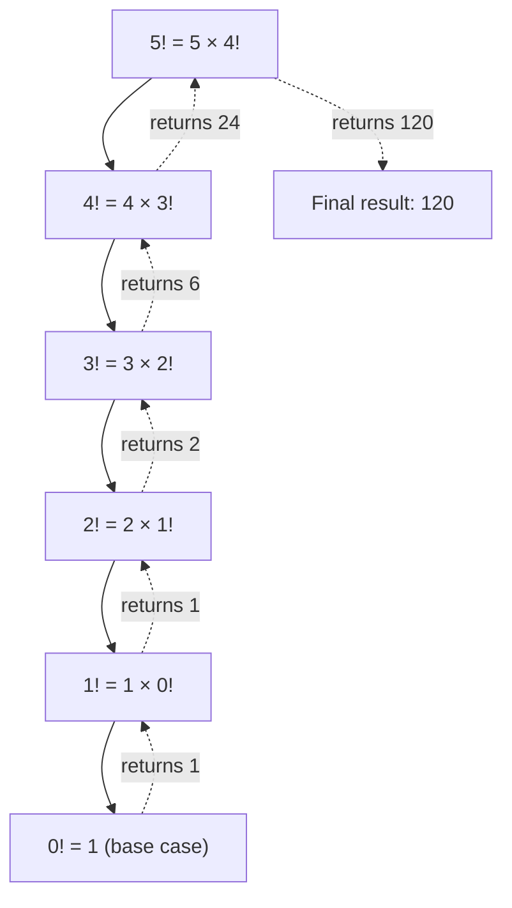

# 12.1 What is Recursion?
Recursion is the act of a method calling itself. A method that invokes itself within its own body is called a **recursive method**. Structurally it resembles an infinite loop — without a stopping condition, the method would keep calling itself indefinitely, eventually exhausting the call stack (a stack overflow, not an infinite hang, since each call consumes memory). A recursive method therefore needs an explicit mechanism to control how many times it repeats.
As a problem-solving technique, recursion breaks a larger problem down into smaller instances of the same problem. It's often used as an alternative to iteration, particularly for problems where the iterative solution is awkward to express. Recursion generally works bottom-up-then-top-down (unwinding as calls return) — though depending on how a problem is framed, this can just as easily be read the other way.

# 12.2 Loop vs Recursion

|             | Loop                                                                                                           | Recursion                                                                |
| ----------- | -------------------------------------------------------------------------------------------------------------- | ------------------------------------------------------------------------ |
| Use case    | Both approaches can solve repetitive problems — there's little functional difference in what they can express. |                                                                          |
| Constructs  | Uses `for`, `while`, etc.                                                                                      | The method calls itself, and relies on a base case and a recursive case. |
| Termination | An explicit loop condition halts execution at some point.                                                      | Execution stops once the base case is reached.                           |
| Complexity  | Can be harder to write for some complex problems.                                                              | Can express complex problems more easily and with more clarity.          |
| Memory      | More memory-efficient.                                                                                         | Uses more memory and resources, with the risk of a stack overflow error. |

# 12.3 Components of a Recursive Method
- **Base Case** — the termination condition that stops the recursion.
- **Recursive Case** — every other case, where the method continues to call itself.
Without a base case, a recursive method has no way to stop calling itself, and will keep pushing new frames onto the call stack until it overflows.

```java title:"General Structure"
static return_type recursive_method(datatype parameter) {
    if (base case condition is satisfied) {
        return final_value;
    } else {                    // recursive case
        recursive_method(argument);
    }
}
```

# 12.4 Method Calling with Recursion
```java
public class recursion {
    public static void main(String[] args) {
        System.out.println(recursive_method(4));   // first call
    }
    static int recursive_method(int num) {
        if (num == 0) {
            return num;                              // base case
        } else {
            return num + recursive_method(num - 1);   // recursive case
        }
    }
}
```

The first call passes `4` as the argument. Each call then invokes `recursive_method` again with a smaller value, until `num == 0` satisfies the base case. At that point the calls begin returning, and each unfinished addition is resolved on the way back up, until the final result reaches `main` and is printed.



# 12.5 Method Call Stack
Every method call is allocated a **stack frame**, which holds information about that call — its local variables, the arguments passed in, and its return value. Recursive calls are no exception: each call to `recursive_method` gets its own frame, stacked on top of the previous one.
For the example in 13.4, the stack builds up like this (most recent call on top), then unwinds as each frame returns:



`recursive_method(4)` is called first, so it sits lowest in the recursive chain (pushed first); `recursive_method(0)` — the base case — is called last and sits on top. Once it returns, frames are popped off the stack one by one as each pending addition completes.

# 12.6 Recursion Example: Factorial
```java title:"Loop-Based approach"
public class factorial {
    public static void main(String[] args) {
        int fact = 1;
        int number = 5;
        for (int i = 1; i <= 5; i++) {
            fact *= i;
        }
        System.out.println(fact);
    }
}
```

```java title:"Recursive approach"
public class factorial {
    public static void main(String[] args) {
        System.out.println(factorial_calculate(5));
    }
    static int factorial_calculate(int n) {
        if (n != 0) {
            return n * factorial_calculate(n - 1);
        } else {
            return 1;   // base case
        }
    }
}
```

A factorial naturally decomposes into smaller sub-problems: `5!` is just `5 × 4!`, `4!` is `4 × 3!`, and so on down to the base case `0! = 1`. The recursive calls unwind back up, multiplying as they go:



# 12.7 Worksheet

**A. Write a recursive method for printing the minimum value in an array.**

```java
public class Task1 {
    public static void main(String[] args) {
        System.out.println(min({1, 3, 4, -3}));
    }
    static int min(int n) {
        // Your code here
    }
}
```
Output: `-3`

**B. Write a recursive method for finding the sum of the first n numbers in a Fibonacci series.**

```java
public class Task2 {
    public static void main(String[] args) {
        System.out.println(fibonacci(5));
    }
    static int fibonacci(int n) {
        // Your code here
    }
}
```
Output: `6`

**C. Write a recursive method that returns the sum of all the elements of an array.**

```java
public class Task3 {
    public static void main(String[] args) {
        System.out.println(sum({1, 3, 4, -3}));
    }
    static int sum(int n) {
        // Your code here
    }
}
```
Output: `5`
